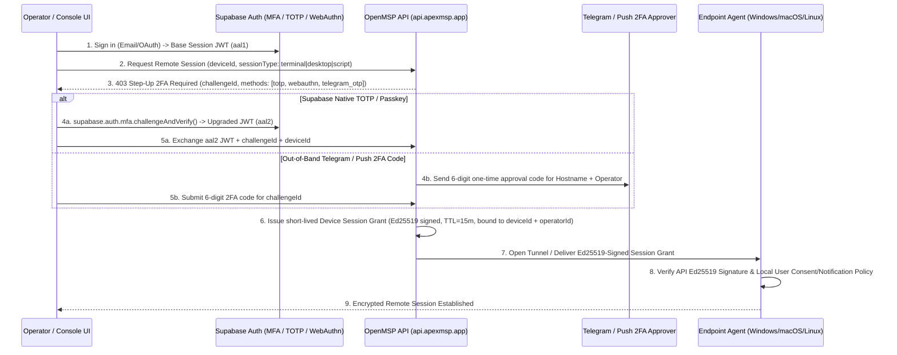

# ApexMSP Planning Notes: Supabase Authentication & Remote Session Step-Up 2FA

**Date:** 2026-10-31  
**Status:** Planned / Architecture Specification  
**Scope:** `apps/console`, `apps/api`, `apps/agent`, and `MeshCentral` / WebSocket PTY / Remote Desktop Relay  

---

## 1. Executive Summary & Goal

1. **Primary Identity Provider Migration to Supabase Auth:**
   - Replace static/local JWT issuance in `apps/api` with **Supabase Auth** (`@supabase/supabase-js` / GoTrue JWT verification via JWKS) as the single source of truth for operator authentication, organization/tenant RBAC, and session lifecycle across `console.apexmsp.app` and `api.apexmsp.app`.
2. **Mandatory Step-Up 2FA at Remote Device Session Initiation:**
   - Whenever an operator or AI agent initiates an interactive remote session with an endpoint (`DESKTOP-*`, servers, POS hosts)—including:
     - **Live Terminal / Shell (`POST /api/v1/mesh/session` & `/ws/v1/` PTY)**
     - **Remote Desktop (`protocol: 2` KVM / RustDesk / VNC Relay)**
     - **Privileged Remote Command / Script Execution (`POST /api/v1/devices/:id/commands` with `run_script`)**
     - **Cross-Device Migration / Restore (`POST /api/v1/backups/snapshots/:id/restore`)**
   - The system **must require a cryptographic 2FA Step-Up verification** binding the authenticated operator to that specific `deviceId` before opening the tunnel or dispatching commands to the machine.

---

## 2. Architecture: Supabase Auth + Step-Up 2FA for Remote Device Access

---

## 3. Implementation Phases

### Phase 1: Supabase Auth Integration (`apps/console` & `apps/api`)
- **Database & Grants Compliance (`TKT-2026-1001`):**
  - All new tables (`public.operator_mfa_challenges`, `public.remote_session_grants`, `public.remote_session_audit_logs`) must include explicit `GRANT SELECT, INSERT, UPDATE, DELETE ON TABLE ... TO authenticated, service_role;` in their SQL migrations.
- **Middleware (`apps/api/src/middleware/auth.ts`):**
  - Verify Supabase JWTs against project JWKS (`SUPABASE_URL/auth/v1/.well-known/jwks.json`) or `SUPABASE_JWT_SECRET`.
  - Inspect the `aal` (Authenticator Assurance Level) claim (`aal1` vs `aal2`) and `amr` (Authentication Methods References) array on the Supabase token.

### Phase 2: Per-Device Remote Session 2FA Challenge (`apps/api/src/middleware/requireDevice2FA.ts`)
- **Protected Endpoints:**
  - `POST /api/v1/mesh/session` (Remote Terminal & Remote Desktop)
  - `POST /api/v1/devices/:id/commands` (`run_script`, `backup_restore`, user creation)
  - `WS /ws/v1/terminal`
- **Step-Up 2FA Verification Modes:**
  1. **Supabase Native MFA (`TOTP` / `WebAuthn` Passkey):** Operator completes a fresh TOTP or hardware passkey check (`amr` timestamp within the last 5 minutes).
  2. **Telegram Out-of-Band Approval (`notify` / Bot Webhook):** Sends a 6-digit one-time code to the owner's Telegram showing `Operator`, `Target Hostname`, `Client`, `Action`, and `Source IP`.
- **Device-Scoped Grant Token (`X-Apex-Device-2FA-Token`):**
  - Once verified, `apps/api` signs an Ed25519 session token scoped strictly to `{ operatorId, deviceId, allowedProtocols, exp: now + 15m }`.
  - Re-authentication is required when switching to a different `deviceId` or after the 15-minute window expires.

### Phase 3: Endpoint Agent Cryptographic Verification (`apps/agent`)
- Embed the control plane's Ed25519 public key into `openmsp-agent`.
- Before executing any remote shell command, user-management action, or file-sync stream, the agent verifies the Ed25519-signed `DeviceSessionGrant` (checking `deviceId`, `exp`, and `nonce` replay protection) and writes an immutable entry to `C:\ProgramData\ApexMSP\audit.log` (and Windows Event Log).
- Optional per-client policy flag (`requireLocalUserPrompt: boolean`) to display a SharkFin tray toast notifying or prompting the logged-in user when a remote session starts.
